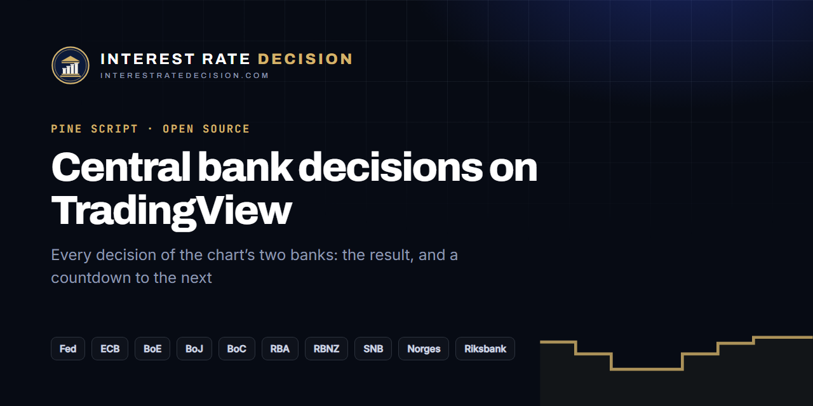

# Central Bank Decisions for TradingView

[](https://interestratedecision.com/calendar/?via=tv-decisions)

A free, open-source Pine Script v6 indicator that marks the interest rate decisions of the two central banks behind the chart's currencies. On EURUSD it shows the ECB and the Fed; on USDJPY the Fed and the Bank of Japan; on XAUUSD or a US index, the Fed.

- **Past decisions** carry their result: hike, hold or cut, by how many basis points, and the new rate.
- **Decisions to come** carry a countdown, and a table lists each bank's next decision and its rate today.
- **An alert** ("Decision within the hour") fires when one of the chart's banks decides within the hour.

Ten banks: the Federal Reserve (USD), European Central Bank (EUR), Bank of England (GBP), Bank of Japan (JPY), Bank of Canada (CAD), Reserve Bank of Australia (AUD), Reserve Bank of New Zealand (NZD), Swiss National Bank (CHF), Norges Bank (NOK) and Sveriges Riksbank (SEK).


<!-- The screenshot is the owner's to take: see docs/republish.md, step 6. -->

## Use it

1. **From TradingView**: search the Indicators menu for "Central Bank Decisions" and add it.
2. **From this repository**: open the Pine Editor, paste [`central-bank-decisions.pine`](central-bank-decisions.pine), and click "Add to chart".

### Settings

| Setting | What it does |
| --- | --- |
| Banks to show | "The chart's two currencies" (the symbol's base and quote currency) or "Every bank ticked below" |
| One tick per bank | Switches a bank off in either mode |
| Past years of decisions | How far back the labels go (0 to every year in the script) |
| Decisions to come | The countdown labels, and how many per bank |
| Vertical line, table, label size | Display |
| Colours | Hike, cut, hold, to come, label text |

Hover a label for the bank's full name, the time in UTC and the result in words.

## The data, and its limits

Pine Script cannot fetch data from outside TradingView, so the decisions are written into the script as one short string per bank. [`scripts/generate.mjs`](scripts/generate.mjs) rebuilds them from InterestRateDecision.com's open data:

- [`/data/decisions.csv`](https://interestratedecision.com/data/decisions.csv?via=tv-decisions): every decision since 2008, with the rate after it and the change in basis points;
- [`/data/next.json`](https://interestratedecision.com/data/next.json?via=tv-decisions): the decisions of the next 90 days and the rate before each;
- [`/calendar.ics`](https://interestratedecision.com/calendar.ics?via=tv-decisions): the dates of the year ahead (only the dates and whether each is provisional are read).

Its limits:

- **History starts on 1 January 2020** (`FIRST_YEAR` in the generator). That keeps the script small and the chart readable; for every decision since 2008 see the [rate history pages](https://interestratedecision.com/central-bank-data/?via=tv-decisions).
- **The published script is a copy.** A GitHub Action regenerates the file every day; the owner republishes it on TradingView once a month ([docs/republish.md](docs/republish.md)), as TradingView has no publishing API. A decision that has passed since the copy was made is labelled "Decided" without a result, and the table says "update" when a bank has no date to come.
- **The Fed's rate is its target range** (the files give its top; the script draws both ends). The Bank of Japan sets no fixed hour: its times are estimates and are marked provisional.
- **Rate decisions only.** No CPI, jobs reports or other releases.
- Why the data is not served by TradingView's Pine Seeds instead: [docs/research.md](docs/research.md).

## Next decisions

<!-- next:start -->
As of 2026-11-03. Times in UTC; the indicator shows them with a countdown.

| Decision | Time (UTC) | Rate before |
| --- | --- | --- |
| [Riksbank November 2026](https://interestratedecision.com/riksbank/november-2026/?via=tv-decisions) | 2026-11-04 08:30 | 1.75% |
| [Norges Bank November 2026](https://interestratedecision.com/norges/november-2026/?via=tv-decisions) | 2026-11-05 09:00 | 4.50% |
| [BoE November 2026](https://interestratedecision.com/boe/november-2026/?via=tv-decisions) | 2026-11-05 12:00 | 3.75% |
| [RBA December 2026](https://interestratedecision.com/rba/december-2026/?via=tv-decisions) | 2026-12-08 03:30 | 4.85% |
| [RBNZ December 2026](https://interestratedecision.com/rbnz/december-2026/?via=tv-decisions) | 2026-12-09 01:00 | 2.75% |
| [BoC December 2026](https://interestratedecision.com/boc/december-2026/?via=tv-decisions) | 2026-12-09 14:45 | 2.50% |
| [Fed December 2026](https://interestratedecision.com/fed/december-2026/?via=tv-decisions) | 2026-12-09 19:00 | 3.75–4.00% |
| [SNB December 2026](https://interestratedecision.com/snb/december-2026/?via=tv-decisions) | 2026-12-10 08:30 | 0.00% |
| [Riksbank December 2026](https://interestratedecision.com/riksbank/december-2026/?via=tv-decisions) | 2026-12-16 08:30 | 1.75% |
| [Norges Bank December 2026](https://interestratedecision.com/norges/december-2026/?via=tv-decisions) | 2026-12-17 09:00 | 4.50% |
| [BoE December 2026](https://interestratedecision.com/boe/december-2026/?via=tv-decisions) | 2026-12-17 12:00 | 3.75% |
| [ECB December 2026](https://interestratedecision.com/ecb/december-2026/?via=tv-decisions) | 2026-12-17 13:15 | 2.50% |

Every date: [the central bank calendar](https://interestratedecision.com/calendar/?via=tv-decisions).
<!-- next:end -->

## Build

Node 18 or later; no dependencies.

```sh
node scripts/generate.mjs          # fetch the data, rewrite central-bank-decisions.pine and the table above
node scripts/generate.mjs --check  # exit 1 if the committed files are out of date
node --test tests/generate.test.mjs # the generator's tests (offline, from tests/fixtures/)
```

Edit [`src/template.pine`](src/template.pine), never the generated file. The generator writes a file only when something other than the "as of" date has changed.

## Licence

The code is under the [MIT licence](LICENSE).

The data is InterestRateDecision.com's: **free to use, including commercially, with a visible link to [InterestRateDecision.com](https://interestratedecision.com/?via=tv-decisions)**. Rates and dates are public facts; the compilation is InterestRateDecision.com's. Full terms: [interestratedecision.com/central-bank-data/](https://interestratedecision.com/central-bank-data/?via=tv-decisions#licence). Economists' consensus is not in the script or in the files it is built from.

Found a wrong date or rate? Open an issue, or see the [corrections log](https://interestratedecision.com/corrections/?via=tv-decisions).

---

Part of the Forexia network: [InterestRateDecision.com](https://interestratedecision.com/?via=tv-decisions) · [Forexia Academy](https://forexiapro.com/?via=tv-decisions) · [TradingSignalBot](https://tradingsignalbot.com/?via=tv-decisions) · [PropSim](https://github.com/PropSim-Enterprise) · [OpenCharts](https://github.com/dylanpersonguy/OpenCharts)
